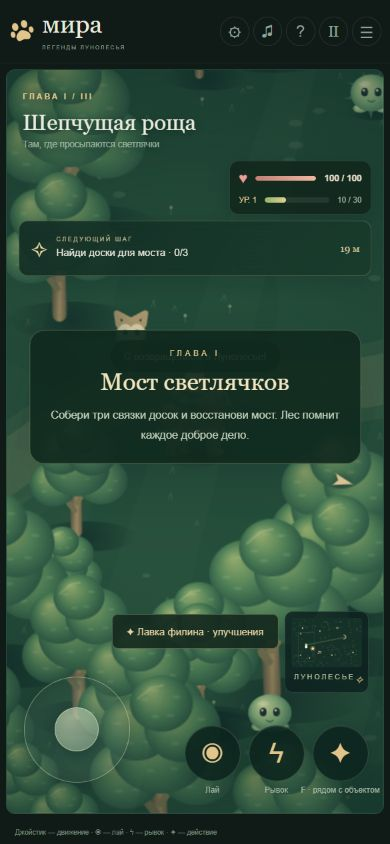

# Результаты проверок Миры
Дата: 24 октября 2026, Москва.
Проверенная версия игрового кода: 9d4ed08da20223447be3182bec16c8bf7a52c8c8.
URL: https://ridalsultanov.github.io/Apps/mira/

## Публикация
Settings → Pages: Your site is live; main / root; HTTPS включён.
Развёртывание: https://github.com/ridalsultanov/Apps/actions/runs/40091124245.
В интерфейсе время развёртывания: 24.10.2026 14:44 GMT+3.
Сама страница открылась, отрисовала игровой мир и интерактивные меню.

## Браузерная проверка этого этапа
Среда: Chrome на Windows, эмуляция размеров экрана и сенсорного ввода. Не Safari.

| Проверка | Наблюдение | Результат |
| --- | --- | --- |
| Загрузка опубликованной игры | Заголовок, лес, Мира и начальное меню отрисованы | Пройдено |
| Начало приключения | Открывается выбор трёх школ, выбор льда закрывает меню | Пройдено |
| Портрет 390×844 | Размер страницы 390×844, горизонтального переполнения нет | Пройдено |
| Сенсорная компоновка | Лай и рывок 56×56 CSS px; джойстик 106×106; всё в пределах экрана | Пройдено |
| Движение джойстиком | Сенсорные события меняют расстояние до цели с 19 до 16 м | Пройдено |
| Два касания | К удержанию джойстика добавлено касание лая; наблюдали перезарядку лая (3,6 с) | Базовая проверка пройдена |
| Альбом 844×390 | Игровое поле и управление в границах экрана, кнопки примерно 50×53, джойстик 90×90 | Управление доступно |
| Размер страницы в альбоме | scrollWidth 844, scrollHeight 398 при innerHeight 390 | Дефект: вертикальные 8 px |
| Настройки | Доступны мягкий режим и живой мир | Пройдено |
| Пауза | Меню сообщает о сохранении и даёт продолжение | Пройдено |
| Перезагрузка | Появляется «Продолжить приключение»; после продолжения восстановлено 10/30 опыта | Пройдено |
| Журнал браузера | В прочитанной выборке предупреждений и ошибок нет | Ошибок не обнаружено |

Ввод выполнялся через браузерную эмуляцию. Плавность, задержки и удобство двух пальцев на реальном телефоне этим не доказаны.
В конце временные размеры и сенсорная эмуляция проверочной вкладки сброшены.

## Доказательство отрисовки

## Автоматические сценарии предыдущего этапа
В PROJECT_STATUS.md до этого этапа записано успешное выполнение восьми сценариев verify.cjs:
1. Старт и выбор школы.
2. Блокировка босса до ремонта моста, материалы и защита от повторной награды.
3. Босс и переход в следующую главу.
4. Спасение и сопровождение друга.
5. Порядок маяков, допуск босса, победа.
6. Сохранение и загрузка выполненных сюжетных задач.
7. Миграция старых сохранений.
8. Вызовы отрисовки монстров, глав и меню настроек/паузы.

Их не запускали заново в текущем этапе; игровой код не менялся. VM использует заглушки рисования и проверяет логику, а не внешний вид.

## Непроверенное
- Физический iPhone и движок Safari.
- Работа после блокировки экрана, сворачивания и установки на экран Домой.
- Полный ручной проход кампании, работа звука и длительная производительность.
- Офлайн-запуск и синхронизация между устройствами не заявляются как проверенные возможности.

## Регрессия самопроизвольной паузы — 24 октября 2026
- Проверка собранного HTML: после запуска `window.blur` оставляет `mode='play'` и пустой `activeDialog`.
- При `document.hidden=true` обработчик сохраняет `mira-moonwood-v1`, но не открывает паузу.
- Синтаксис изменённых `game.js`, `verify.cjs` и всех трёх встроенных скриптов итогового HTML проверен.
- В `verify.cjs` добавлен девятый сценарий `background events save without opening pause`.
- Проверка выполнена в VM/эмуляции; физический Safari ещё не проверен.

## Проверка визуального апгрейда «почти 3D» — 24 октября 2026
- Синтаксис `polish.js` и трёх встроенных скриптов итоговой сборки проверен.
- В VM выполнена отрисовка Миры, обычных монстров, трёх боссов и полного кадра во всех трёх главах.
- Регрессия паузы проверена повторно: `window.blur` оставляет игру в `mode='play'`.
- В сборке присутствует новый экранный проход глубины и псевдо-3D CSS.
- Реальная производительность Safari и визуальная оценка на физическом iPhone остаются пользовательской проверкой.
